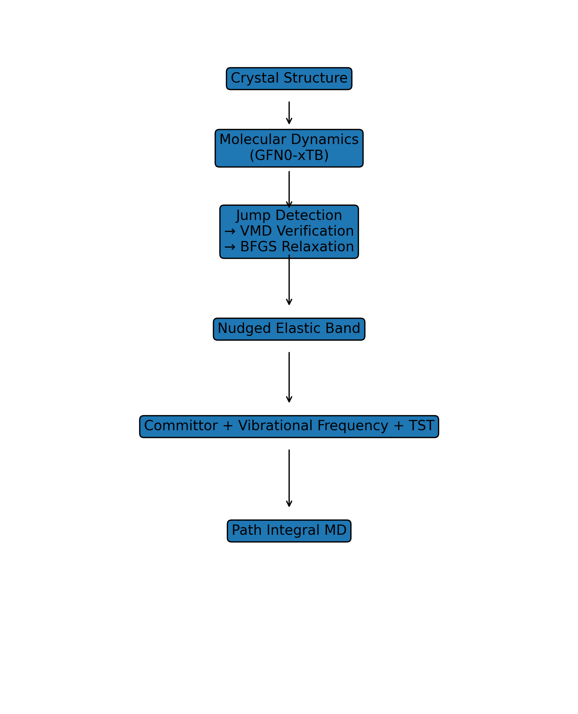
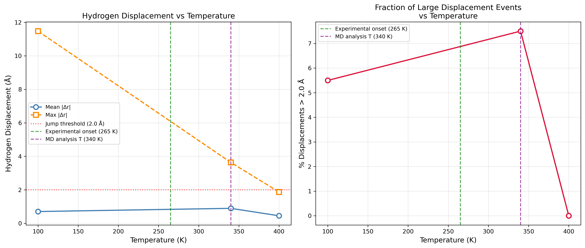

# Hydrogen diffusion in LiBeH₃

Code from my undergraduate dissertation at Cardiff University (2026), awarded 83% and the prize for the highest mark in the cohort.

LiBeH₃ is the lightest known reversible metal hydride (15.93 wt% hydrogen). Experiments show its hydrogen sublattice suddenly becomes mobile above about 265 K, but the atomistic mechanism behind this was unknown. This project used semi-empirical molecular dynamics, nudged elastic band (NEB) calculations and transition state theory to explain it.

**Main results**

- Molecular dynamics with GFN0-xTB identified hydrogen hopping events at 340 K.
- NEB calculations found a cooperative three-hydrogen diffusion mechanism around a BeH₉ structural unit, in which the central beryllium inverts through a trigonal planar transition state (analogous to Berry pseudorotation).
- The transition state was confirmed three ways: a committor probability of 0.556, a single imaginary vibrational frequency (553.26i cm⁻¹), and the NEB energy maximum.
- Transition state theory gives a transition-state probability that rises about 15-fold between 255 K and 280 K, consistent with the experimental onset at 265 K.



## Workflow

The scripts follow the order of the analysis:

1. **`md/`**: Langevin molecular dynamics of the periodic LiBeH₃ cell with GFN0-xTB through ASE, at fixed temperatures (100–700 K) and with temperature ramps. Includes pre-relaxation, restarting from a frame, and log analysis (temperature and energy).
2. **`hop_detection/`**: finds hydrogen site-to-site jumps in the trajectories. Positions are unwrapped across periodic boundaries, and a jump is counted when a hydrogen's displacement over a fixed time lag (e.g. 2.0 Å over 1 ps) passes a threshold, using rising-edge detection so each jump is counted once. Also assigns hydrogens to their nearest Be site, builds jump histograms across temperatures and random seeds, and exports short trajectory windows around each event for inspection in VMD.
3. **`neb/`**: extracts the start and end geometries of each detected hop, relaxes them, and runs NEB and climbing-image NEB with xTB (including a variant with Li atoms frozen). Scripts summarise many NEB runs, average repeat runs with standard deviations, and plot energy profiles.
4. **`transition_state/`**: refines the saddle point with the dimer method, runs committor analysis from the transition state, calculates vibrational frequencies of the active region, and compares vibrational partition functions for transition state theory.
5. **`pimd/`**: an xTB driver for path-integral MD with i-PI (`input.xml` is the i-PI setup), used with my supervisor to test nuclear quantum effects, and a comparison of xTB against the PET-MAD machine-learned potential.
6. **`utils/`**: fractional-to-Cartesian conversion of the crystal structure, structure building, and relabelling an atom in an XYZ file so a hopping hydrogen stands out in VMD.



## Requirements

Python 3.10+ with the packages in `requirements.txt`. The xTB calculator comes from [xtb-python](https://github.com/grimme-lab/xtb-python), which is easiest to install with conda:

```bash
conda create -n xtb-md -c conda-forge python=3.11 xtb-python ase numpy matplotlib
conda activate xtb-md
```

Most scripts take command-line arguments; run `python <script>.py --help` to see them. For example, a 340 K run:

```bash
python md/xtb_md_340K.py structure.xyz \
  --a 6.0138 --b 6.1251 --c 13.1242 --alpha 90 --beta 82.3646 --gamma 90 \
  --temperature 340 --timestep 0.25 --steps 150000
```

## Notes

This is research code as I used it during the project, organised into folders afterwards. Trajectories and other large outputs are not included. Some scripts are earlier iterations of the same step, kept to show how the method developed.
